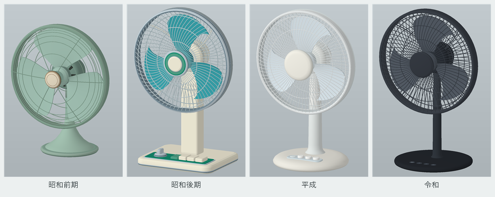

# 扇風機（SYNC_StandFan）

昭和前期から令和まで、4種類の扇風機を描画する AviUtl2 用の3Dメディアオブジェクトです。羽根の回転、加減速、速度ごとの残像を表現できます。

**v1.0.0** · Windows 64ビット · AviUtl2 2.1.16 以降

## インストール・更新

1. AviUtl2 を終了し、[SYNC_StandFan.zip](https://github.com/vramwiz/SYNC_StandFan/releases/download/v1.0.0/SYNC_StandFan.zip) を展開します。
2. 展開した **SYNC_StandFan** フォルダーを AviUtl2 のプラグインフォルダーへコピーします。標準の配置先は **C:\ProgramData\aviutl2\Plugin** です。更新時は同じ場所に上書きします。
3. AviUtl2 を起動し、タイムラインのメディアオブジェクト **「SYNC」→「扇風機」** を追加します。

アンインストールするときは、AviUtl2 を終了して、プラグインフォルダー内の **SYNC_StandFan** フォルダーを削除します。

## 機種を選ぶ

| プリセット | 外観と操作部 |
| --- | --- |
| 昭和前期 | 薄緑の円錐形台座、大きな羽根、間隔の広いガード。固定式の卓上型 |
| 昭和後期 | 白い角柱、緑の操作パネル、青緑の羽根。選んだ運転ボタンが沈む |
| 平成 | 白い丸形台座と円柱ボタン、淡い青みのある白い羽根。選んだ運転ボタンが沈む |
| 令和 | 薄い円形の台座と細い支柱を持つ黒系の機種。タッチ式風の操作部では選んだマークが明るくなる |

位置・拡大率・回転は AviUtl2 標準の「描画」で調整します。「カメラ制御」の対象にすると、側面や背面、上方にも視点を移せます。

## 羽根・首振り・配色

- **羽の枚数**は3〜6枚から選べます。初期値は3枚です。
- **運転状態**は「切・弱・中・強」から選びます。オブジェクトの先頭では停止しており、運転を選ぶと加速します。弱では羽根ごとの流れが見え、中では残像が重なり、強ではなめらかな円盤状になります。
- **首振り方式**を「横」にすると、中央から左右に往復します。首振り速度100で約8秒に1往復し、「横可動範囲」で中央から片側までの角度を調整できます。**首上の長さ**で支柱とヘッドの高さを調整できます。昭和前期は固定式です。
- **色設定**では羽、カバー、モーター収納部、首上、首下、土台、土台のアクセントを変更できます。色項目が既定値なら機種ごとの標準色が適用され、設定した色はプリセットを切り替えても引き継がれます。

## 途中で運転を切り替える

中間点を追加し、**「運転状態（区間）」を「瞬間移動」**に設定して、区間ごとに値を指定します。

| 値 | 運転状態 |
| --- | --- |
| -1 | 「運転状態」セレクタに従う |
| 0 | 切 |
| 1 | 弱 |
| 2 | 中 |
| 3 | 強 |

減速して止まるところまで映すには、オブジェクトの終端より前に中間点を置き、その区間の値を **0** にします。

## ライセンス

[GPL-3.0](LICENSE) · [第三者ライセンス表示](THIRD_PARTY_NOTICES.md)
